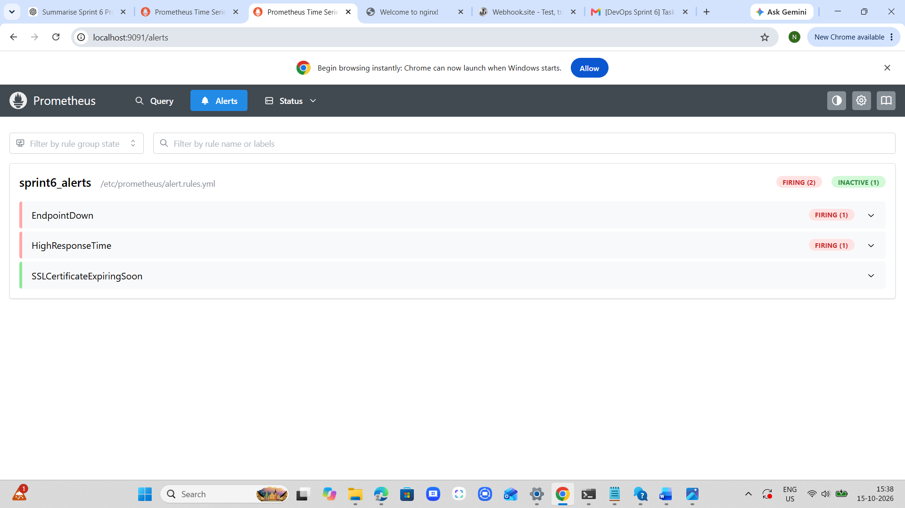
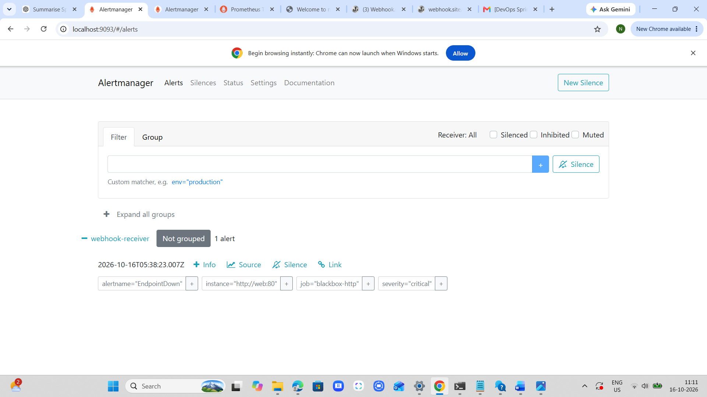
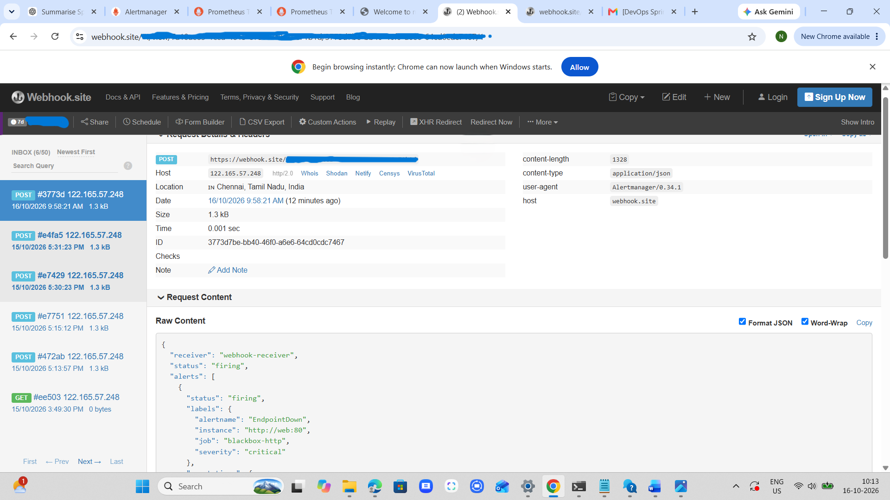

# Sprint 6 – Endpoint Probing & Automated Alerting with Alertmanager

## 1. Project Overview

The aim of this project is to monitor a web application and automatically send notifications when a problem occurs.

We use **Prometheus, Blackbox Exporter, Alertmanager, and Docker Compose**.

The project monitors three main conditions:

* Whether the web application is running and returning HTTP 200.
* Whether the endpoint response time is too high.
* Whether an SSL certificate will expire within 30 days.

When an alert is triggered, Prometheus sends it to Alertmanager. Alertmanager then sends a notification to Webhook.site.

## 2. Tools Used

| Tool              | Purpose                                    |
| ----------------- | ------------------------------------------ |
| Docker Compose    | Runs all services together                 |
| Nginx             | Sample web application                     |
| Blackbox Exporter | Checks HTTP/HTTPS endpoints                |
| Prometheus        | Collects metrics and evaluates alert rules |
| Alertmanager      | Receives and forwards alerts               |
| Webhook.site      | Receives webhook notifications             |

## 3. How the Project Works

1. Docker Compose starts four services: Prometheus, Blackbox Exporter, Alertmanager, and Nginx.
2. Blackbox Exporter checks the Nginx HTTP endpoint and an external HTTPS endpoint.
3. Prometheus collects the probe results every 15 seconds.
4. Prometheus checks whether any alert condition is met.
5. If an alert fires, Prometheus sends it to Alertmanager.
6. Alertmanager forwards the notification to Webhook.site.

## 4. Project Files

| File                 | Purpose                                        |
| -------------------- | ---------------------------------------------- |
| `docker-compose.yml` | Defines the four services                      |
| `prometheus.yml`     | Configures monitoring targets and Alertmanager |
| `blackbox.yml`       | Configures HTTP and HTTPS probes               |
| `alert.rules.yml`    | Contains the three alert rules                 |
| `alertmanager.yml`   | Public webhook configuration template          |
| `ssl-alert-test.yml` | Tests the SSL expiry alert                     |
| `.gitignore`         | Protects the private webhook configuration     |
| `README.md`          | Project documentation                          |
| `screenshots/`       | Contains the proof-of-work screenshots         |

The private `alertmanager.local.yml` file is created locally and is not uploaded to GitHub.

## 5. Docker Services

| Service           | Container Name       | Access                |
| ----------------- | -------------------- | --------------------- |
| Prometheus        | sprint6-prometheus   | http://localhost:9091 |
| Blackbox Exporter | sprint6-blackbox     | http://localhost:9115 |
| Alertmanager      | sprint6-alertmanager | http://localhost:9093 |
| Nginx             | sprint6-web          | http://localhost:8080 |

## 6. Monitoring Configuration

**HTTP monitoring**

Blackbox Exporter monitors `http://web:80` using the `http_200` module.

It checks:

* `probe_success` – whether the endpoint is reachable.
* `probe_http_status_code` – whether the endpoint returns HTTP 200.
* `probe_duration_seconds` – how long the probe takes.

**SSL monitoring**

The `https_ssl` module monitors `https://example.com`.

The metric `probe_ssl_earliest_cert_expiry` is used to calculate the remaining certificate validity.

## 7. Alert Rules

Three alerts are configured in `alert.rules.yml`.

### Alert 1: EndpointDown

**Condition:** The HTTP endpoint probe fails continuously for 1 minute.

Expression:

`probe_success{job="blackbox-http"} == 0`

Severity: **Critical**

### Alert 2: HighResponseTime

**Condition:** A successful HTTP probe takes more than 2 seconds continuously for 1 minute.

Expression:

`probe_duration_seconds{job="blackbox-http"} > 2 and on(instance, job) (probe_success{job="blackbox-http"} == 1)`

Severity: **Warning**

The success condition ensures that a failed endpoint does not incorrectly trigger the latency alert.

### Alert 3: SSLCertificateExpiringSoon

**Condition:** A successfully probed SSL certificate has fewer than 30 days remaining before expiry, continuously for 1 minute.

Expression:

`(probe_ssl_earliest_cert_expiry{job="blackbox-ssl"} - time()) / 86400 < 30 and on(instance, job) (probe_success{job="blackbox-ssl"} == 1)`

Severity: **Warning**

## 8. How to Run the Project

**Step 1: Configure the webhook**

Create the private configuration file:

`cp alertmanager.yml alertmanager.local.yml`

Open it:

`nano alertmanager.local.yml`

Replace `REPLACE_WITH_YOUR_WEBHOOK_ID` with your own Webhook.site ID.

**Step 2: Validate Docker Compose**

`docker compose config -q`

**Step 3: Start all services**

`docker compose up -d`

**Step 4: Check container status**

`docker compose ps`

All four containers should be running.

## 9. Testing and Results

### Test 1: HTTP Monitoring

The following Prometheus queries were checked:

| Query                                         | Verified result         |
| --------------------------------------------- | ----------------------- |
| `probe_success{job="blackbox-http"}`          | 1                       |
| `probe_http_status_code{job="blackbox-http"}` | 200                     |
| `probe_duration_seconds{job="blackbox-http"}` | Displays probe duration |

This confirmed that the Nginx endpoint was working correctly.

### Test 2: Endpoint Failure and Webhook Notification

The Nginx container was intentionally stopped using:

`docker compose stop web`

After the configured alert duration:

* `EndpointDown` changed to **FIRING** in Prometheus.
* Alertmanager received the critical alert.
* Webhook.site received an actual POST notification containing `EndpointDown`, `critical`, and `firing`.

### Test 3: Endpoint Recovery

Nginx was restarted using:

`docker compose start web`

After recovery:

* `probe_success` returned to `1`.
* `EndpointDown` returned to **INACTIVE**.

### Test 4: SSL Certificate Monitoring

The following queries were verified:

* `probe_success{job="blackbox-ssl"}` returned `1`.
* The certificate expiry query showed approximately **70.75 days remaining** during testing.

Since the remaining validity was greater than 30 days, the SSL expiry alert correctly remained inactive.

### Test 5: Alert Rule Validation

Command:

`docker exec sprint6-prometheus promtool check rules /etc/prometheus/alert.rules.yml`

Result: **SUCCESS: 3 rules found**

### Test 6: SSL Expiry Alert Unit Test

The SSL alert was tested using simulated metrics in `ssl-alert-test.yml`.

Command:

`docker run --rm -v "$PWD:/workspace:ro" -w /workspace --entrypoint promtool prom/prometheus:latest test rules ssl-alert-test.yml`

Result: **SUCCESS**

This confirmed that the SSL alert triggers correctly when a successful probe reports a certificate expiry within 30 days.

## 10. Proof of Work

### Screenshot 1 – Prometheus FIRING Alert

### Screenshot 2 – Alertmanager Received Alert

### Screenshot 3 – Actual Webhook Notification

The private webhook URL is masked in the submitted screenshot.

## 11. Security Note

The public `alertmanager.yml` contains only a placeholder webhook URL.

The actual URL is stored in `alertmanager.local.yml`, which is excluded from Git using `.gitignore`.

## 12. Conclusion

This project successfully implements automated endpoint monitoring using Prometheus and Blackbox Exporter.

HTTP availability, response time, and SSL certificate expiry monitoring were configured. Endpoint failure, alert delivery, webhook notification, recovery, and SSL alert testing were successfully verified.
