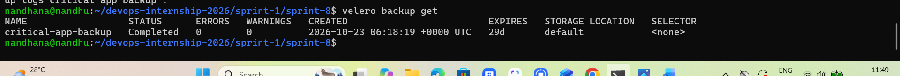
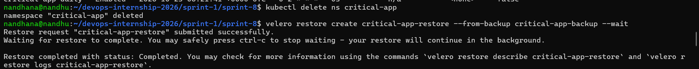
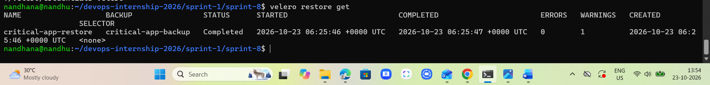
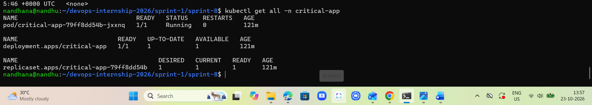

# Sprint 8 – Kubernetes Disaster Recovery with Velero and MinIO

## 1. Project Overview

This project demonstrates Kubernetes application disaster recovery using Velero and MinIO as S3-compatible backup storage.

A sample Nginx application is deployed in the `critical-app` namespace with a ConfigMap and Deployment.

Velero backs up the namespace to MinIO. Disaster recovery is tested by completely deleting the namespace and restoring it from the completed backup.

## 2. Environment and Tools

- Ubuntu 24.04 (WSL2)
- Docker
- Kind – Local Kubernetes cluster (`sprint8`)
- kubectl
- Velero CLI v1.17.0
- Velero AWS plugin v1.13.0
- MinIO – S3-compatible object storage
- Nginx – Sample application

## 3. Project Structure

```text
sprint-8/
├── .gitignore
├── README.md
├── app/
│   ├── namespace.yaml
│   ├── configmap.yaml
│   └── deployment.yaml
├── minio/
│   └── minio.yaml
├── velero/
│   └── credentials-velero (local only; Git-ignored)
├── scripts/
│   ├── setup-minio.sh
│   ├── setup-velero.sh
│   ├── backup.sh
│   ├── schedule.sh
│   └── restore.sh
└── screenshots/
    ├── sprint8-backup-status.png
    ├── sprint8-namespace-deletion.png
    ├── sprint8-restore-status.png
    └── sprint8-recovered-app.png
```

## 4. MinIO Setup

Create the MinIO credentials as a Kubernetes Secret before deployment. Use matching credentials in the local Velero credentials file. Do not commit real credentials to Git.

```bash
kubectl create secret generic minio-credentials \
  --from-literal=root-user=minioadmin \
  --from-literal=root-password=YOUR_MINIO_PASSWORD
```

Deploy MinIO:

```bash
bash scripts/setup-minio.sh
```

Access the MinIO console:

```bash
kubectl port-forward svc/minio 9001:9001
```

Open `http://localhost:9001`.

Create a private bucket named:

```text
k8s-backups
```

MinIO provides S3-compatible storage for Velero backups.

## 5. Velero Setup

Create `velero/credentials-velero` locally using the MinIO credentials.

The credentials file is excluded from Git using `.gitignore`.

Install Velero:

```bash
bash scripts/setup-velero.sh
```

Verify that the backup storage location is available:

```bash
velero backup-location get
```

The configured storage location uses the MinIO bucket `k8s-backups`.

## 6. Deploy Sample Application

```bash
kubectl apply -f app/namespace.yaml
kubectl apply -f app/configmap.yaml
kubectl apply -f app/deployment.yaml
```

Verify the application:

```bash
kubectl get all -n critical-app
kubectl get configmap -n critical-app
```

The Deployment runs one Nginx replica and references the application ConfigMap.

## 7. Manual Backup

Create a manual Velero backup:

```bash
bash scripts/backup.sh
```

Equivalent backup command:

```bash
velero backup create critical-app-backup --include-namespaces critical-app --wait
```

Verified result:

- Backup: `critical-app-backup`
- Status: `Completed`
- Errors: `0`
- Warnings: `0`

### Backup Proof



## 8. Automated Daily Backup

Create the daily backup schedule:

```bash
bash scripts/schedule.sh
```

Equivalent command:

```bash
velero schedule create critical-app-daily --schedule="0 2 * * *" --include-namespaces critical-app
```

Verify:

```bash
velero schedule get
```

The schedule was verified as `Enabled`.

The cron expression `0 2 * * *` schedules backups daily at 02:00 UTC (07:30 AM IST).

## 9. Disaster Recovery Test

### Delete the Namespace

The complete sample application namespace was intentionally deleted:

```bash
kubectl delete ns critical-app
```

Output:

```text
namespace "critical-app" deleted
```

### Deletion Proof



### Restore from Backup

Restore the deleted namespace:

```bash
bash scripts/restore.sh
```

Equivalent restore command:

```bash
velero restore create critical-app-restore --from-backup critical-app-backup --wait
```

Verified result:

- Restore: `critical-app-restore`
- Status: `Completed`
- Items restored: `7/7`
- Errors: `0`
- Warnings: `1`

The warning occurred because Kubernetes had already recreated the automatically managed `kube-root-ca.crt` ConfigMap. It did not affect recovery of the sample application.

### Restore Proof



## 10. Recovery Verification

Verify the recovered Kubernetes resources:

```bash
kubectl get all -n critical-app
```

Verified results:

- Application Pod: `1/1 Running`
- Deployment: `1/1 Ready`
- ReplicaSet: `1/1 Ready`
- Container restarts: `0`

### Recovered Application Proof



The application ConfigMap was also verified:

```bash
kubectl get configmap critical-app-config -n critical-app -o yaml
```

Recovered configuration:

```yaml
data:
  APP_ENV: production
  APP_NAME: critical-app
```

The application and ConfigMap were restored by Velero without manually reapplying their manifests.

## 11. Result

The Kubernetes application disaster recovery test was successful.

The project demonstrates manual backups, automated daily backup scheduling, complete namespace deletion, Velero restoration, and verification of recovered application resources.

MinIO runs inside the local Kind cluster. This demonstration validates application namespace recovery, not recovery from complete cluster or MinIO storage loss.
