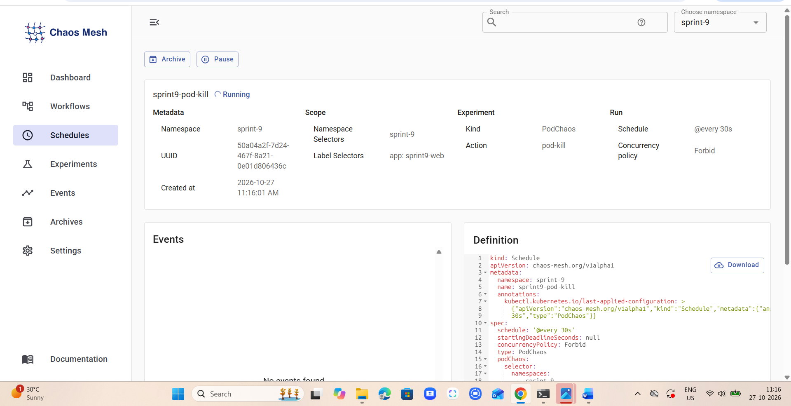
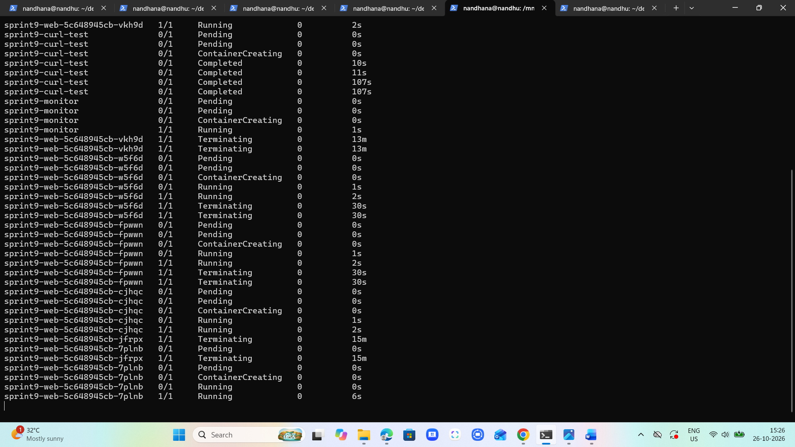
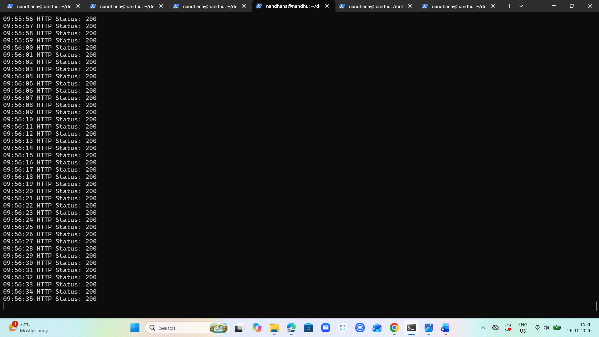
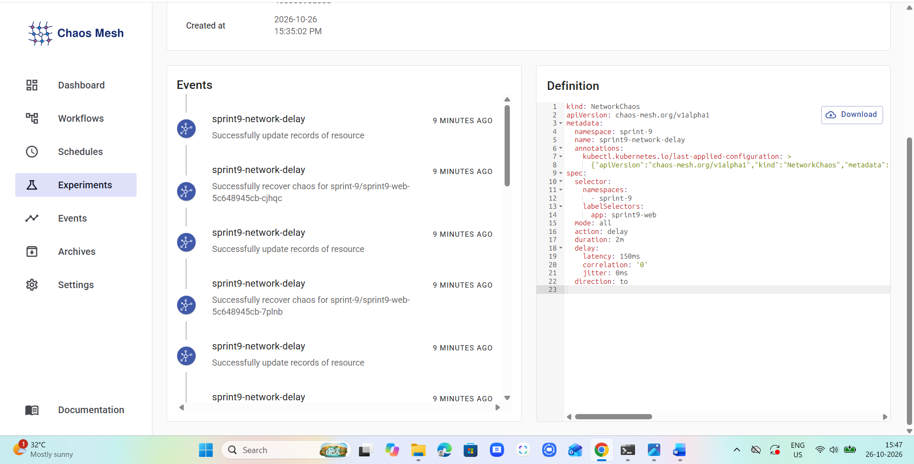

# Sprint 9 – Chaos Engineering & High-Availability Verification

## Project Overview

This project demonstrates Chaos Engineering using Chaos Mesh on a local Kubernetes kind cluster.

A three-replica Nginx application with an HTTP ReadinessProbe is tested using PodKill and NetworkChaos experiments to verify application availability and recovery.

## Environment

- Kubernetes: kind (local cluster)
- Namespace: `sprint-9`
- Chaos Mesh: v2.8.6
- Application: Nginx (`nginx:1.27-alpine`)
- Replicas: 3

## Project Files

| File | Purpose |
|---|---|
| `deployment.yaml` | Application Deployment, ReadinessProbe and Service |
| `pod-chaos.yaml` | Scheduled PodKill experiment |
| `network-chaos.yaml` | 150ms network delay experiment |
| `availability-check.sh` | Continuous HTTP availability checker |
| `screenshots/` | Experiment evidence |

## 1. Install Chaos Mesh

Add the Chaos Mesh Helm repository:

```bash
helm repo add chaos-mesh https://charts.chaos-mesh.org
helm repo update
```

Install Chaos Mesh v2.8.6 on the local kind cluster:

```bash
helm install chaos-mesh chaos-mesh/chaos-mesh \
  --namespace chaos-mesh --create-namespace \
  --version 2.8.6 \
  --set chaosDaemon.runtime=containerd \
  --set chaosDaemon.socketPath=/run/containerd/containerd.sock
```

Verify installation:

```bash
kubectl get pods -n chaos-mesh
```

## 2. Deploy the Application

```bash
kubectl create namespace sprint-9
kubectl apply -f deployment.yaml
kubectl get pods -n sprint-9
```

The Deployment maintains three Nginx replicas. Its HTTP ReadinessProbe checks the `/` endpoint on port 80.

## 3. Continuous Availability Monitoring

Create a monitoring pod inside the Kubernetes cluster:

```bash
kubectl run sprint9-monitor -n sprint-9 \
  --image=curlimages/curl:8.12.1 \
  --restart=Never \
  --command -- sleep 3600
```

Copy and run the availability checker:

```bash
kubectl cp availability-check.sh sprint-9/sprint9-monitor:/tmp/availability-check.sh
kubectl exec -it -n sprint-9 sprint9-monitor -- sh /tmp/availability-check.sh
```

The checker sends one HTTP request per second through the Kubernetes Service.

- HTTP 200 indicates a successful response.
- HTTP 000 indicates a failed request or timeout.

Keep the monitoring terminal running during both experiments.

## 4. PodKill Experiment

Apply the declarative PodKill Schedule:

```bash
kubectl apply -f pod-chaos.yaml
```

The Schedule randomly kills one application pod every 30 seconds. Kubernetes creates replacement pods to maintain three replicas.

Observe pod termination and recovery in another terminal:

```bash
kubectl get pods -n sprint-9 -w
```

Run the experiment for approximately two minutes, then manually stop the recurring Schedule:

```bash
kubectl delete -f pod-chaos.yaml
```

## 5. NetworkChaos Experiment

Apply the declarative NetworkChaos manifest:

```bash
kubectl apply -f network-chaos.yaml
```

This experiment injects 150ms network latency into all selected application pods for two minutes.

Verify the experiment:

```bash
kubectl describe networkchaos sprint9-network-delay -n sprint-9
```

Check recovery:

```bash
kubectl get networkchaos sprint9-network-delay -n sprint-9 \
  -o jsonpath='{range .status.conditions[*]}{.type}={.status}{"\n"}{end}'
```

The condition `AllRecovered=True` confirms that the injected network fault has been recovered.

## 6. Chaos Mesh Dashboard

Access the Dashboard using port forwarding:

```bash
kubectl port-forward -n chaos-mesh svc/chaos-dashboard 2333:2333
```

Open http://localhost:2333 in a browser.

Generate a temporary Dashboard login token:

```bash
kubectl create token chaos-dashboard -n chaos-mesh --duration=15m
```

Enter a login name and paste the generated token into the Dashboard login page.

Do not commit or share the token.

Select namespace `sprint-9` to view the PodKill Schedule and NetworkChaos experiment.

## 7. Test Results

### PodKill

- The experiment terminated application pods every 30 seconds during the two-minute test.
- Kubernetes automatically created replacement pods to maintain three replicas.
- The availability checker showed continuous HTTP 200 responses during the observed test.

### NetworkChaos

- Chaos Mesh successfully injected 150ms network latency into all three application pods.
- During the monitored retest, all observed HTTP responses were 200, with no observed timeouts.
- After two minutes, Chaos Mesh reported `AllRecovered=True`.

The application remained available during the observed tests and recovered from the injected failures.

## 8. Screenshots

### PodKill Dashboard



### Pod Termination and Recovery



### HTTP Availability Monitoring



### NetworkChaos Dashboard


